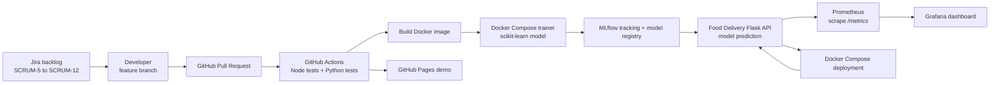

# Assignment 2 — End-to-end DevOps architecture



**Lifecycle:** prioritized Jira stories → feature branch and pull request → automated build/tests → Docker image → Compose services → MLflow experiment, metrics and registered model → prediction API → Prometheus scraping → Grafana dashboard. GitHub Pages separately hosts the browser-only demo. Compose-hosted API/ML services are for local or CI demonstration.

**Run locally** (Docker Desktop / Docker Compose required):

```bash
docker compose build
docker compose up -d mlflow
docker compose --profile train run --rm trainer
docker compose up -d app prometheus grafana
```

Open the API at `http://localhost:8000/health`, MLflow at `http://localhost:5000`, Prometheus at `http://localhost:9090`, and Grafana at `http://localhost:3000` (`admin` / `food-demo` by default; change `GRAFANA_PASSWORD` outside the demo). Generate a prediction using:

```bash
curl -X POST http://localhost:8000/predict -H "Content-Type: application/json" -d "{\"order_size\":2,\"distance_km\":3.5}"
```

Tear down the demo with `docker compose down`. CI execution evidence is linked in the GitHub Actions tab; attach screenshots of the successful jobs and Grafana/MLflow pages for submission.
